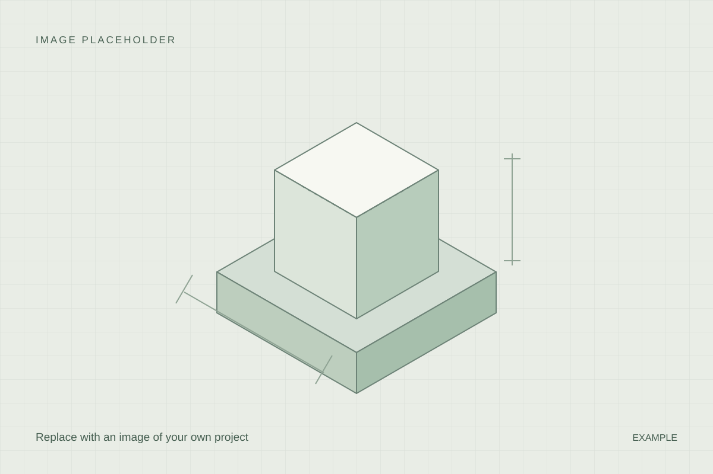

## At a glance

[Add a short, accessible explanation of the project. Describe what it does and what the outcome was, so a reader without a technical background can follow along.]

## What I wanted to build

[Describe the need or idea behind the project and what you wanted to achieve.]

## My contribution

[Describe what you designed, built or programmed yourself. Identify any ready-made components and contributions from others.]

## Design and build process

[Describe the main steps, tools and decisions. Use images to show the process.]

*Placeholder caption: Explain what the image shows and why it matters.*

## How it works

[Start with the basic principle. Add technical details and any relevant equations here, after the accessible overview.]

This equation demonstrates formatting only and is not connected to a real project:

$$
f(x) = x^2
$$

[Replace or remove this example. Explain symbols and units if you include equations.]

## Challenges, testing and results

[Describe what you actually investigated and observed. Add your own measurements and results when they are available.]

## What I learned

[Describe what you learned and what you might do differently next time.]

## Links and files

[Add real links to code, CAD models or other files in the metadata if relevant. Remove this placeholder section when it is no longer needed.]
